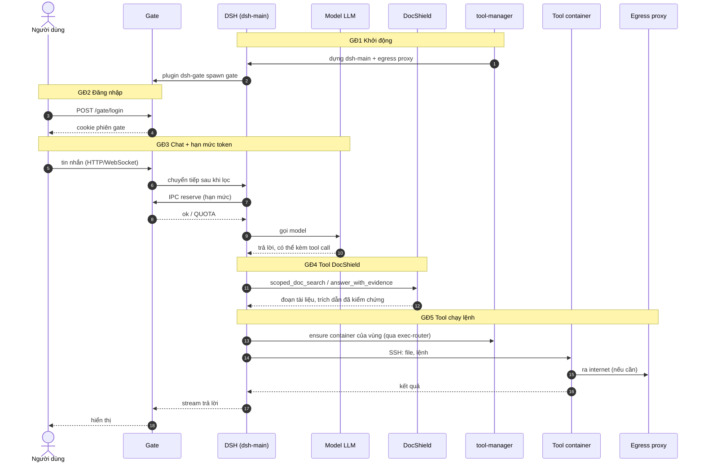
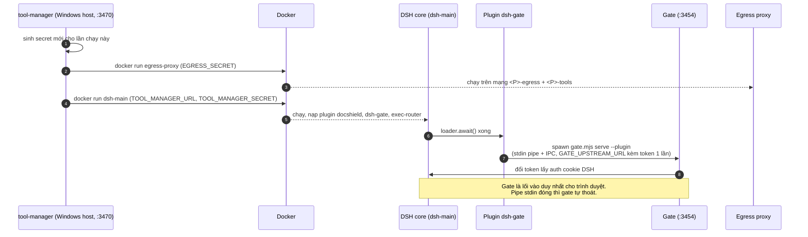
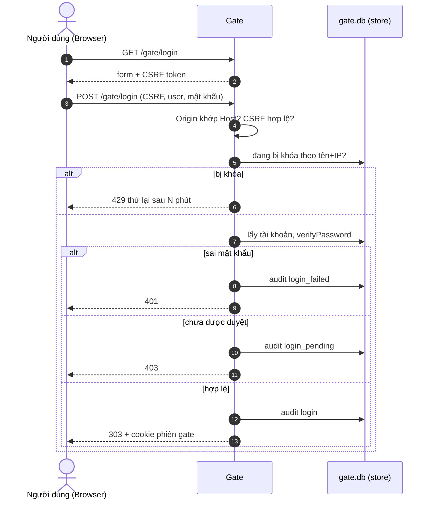
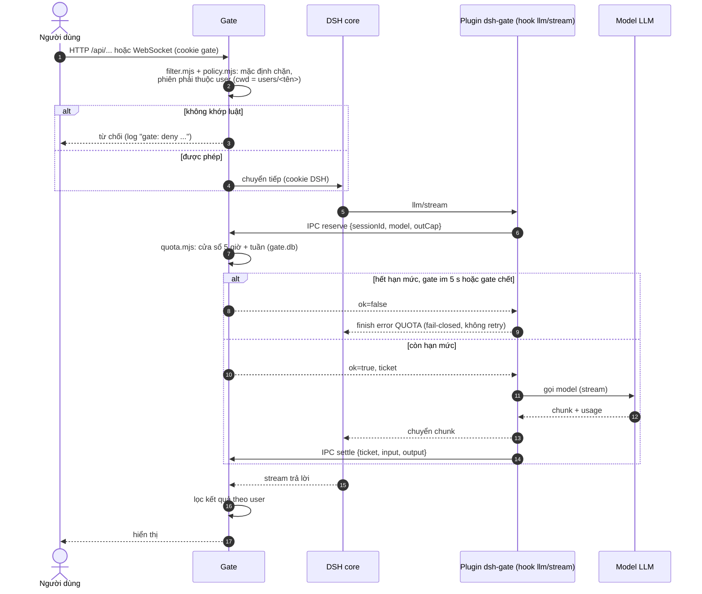
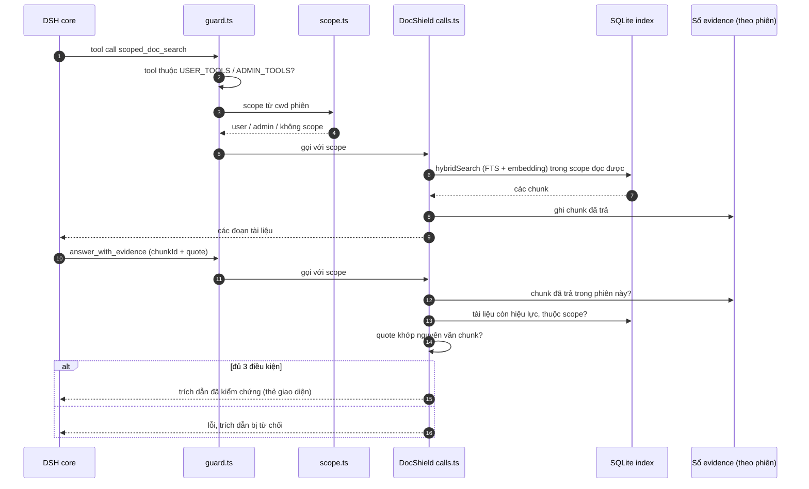
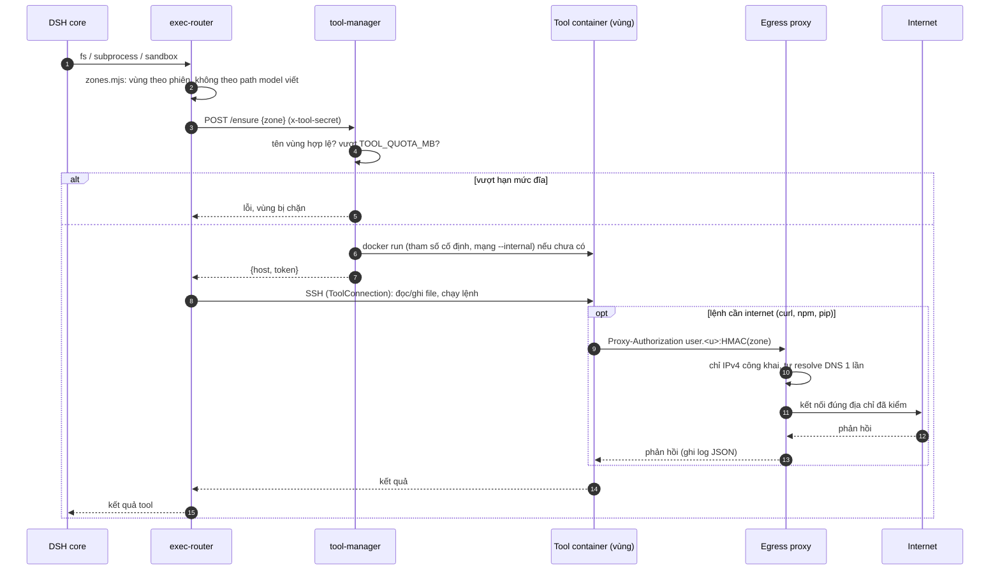

# Luồng xử lý DSH-DocShield

Tài liệu gồm một sơ đồ tổng quát và 5 sơ đồ chi tiết, mỗi giai đoạn một sơ đồ.
Chưa có trong sơ đồ: đăng ký, trang `/gate/admin` và `/gate/usage`, upload file, watcher nạp tài liệu.

## Tổng quát

Giai đoạn 1 chạy một lần khi hệ thống bật. Giai đoạn 2 chạy một lần cho mỗi phiên đăng nhập. Giai đoạn 3 lặp lại ở mỗi lượt gọi model. Giai đoạn 4 và 5 chỉ xảy ra khi model gọi tool, và kết quả tool quay lại giai đoạn 3 (gọi model tiếp).

## Giai đoạn 1. Khởi động

`exec-router/tool-manager.mjs` chạy trên Windows và là thành phần duy nhất gọi Docker. Mỗi lần chạy, nó cấp secret mới và chỉ truyền qua biến môi trường. Khi DSH nạp xong plugin, `gate/plugin/index.mjs` spawn gate làm tiến trình con, có kênh IPC. Gate đổi token dùng một lần lấy cookie của DSH. Trình duyệt không bao giờ có cookie này. DSH dừng thì gate cũng dừng.

## Giai đoạn 2. Đăng nhập

`gate/src/app.mjs` kiểm tra CSRF và chặn POST/WebSocket có `Origin` khác `Host`. Đăng nhập sai nhiều lần thì bị khóa theo tên+IP. Tài khoản chưa được admin duyệt bị từ chối. Mọi kết quả đều được ghi audit.

## Giai đoạn 3. Chat và hạn mức token

- `gate/src/filter.mjs` và `gate/src/policy.mjs` mặc định chặn. User thường chỉ gọi được các API và tin WebSocket có trong danh sách, và chỉ trên phiên của mình. Danh tính lấy từ cwd phiên `users/<tên>`. Admin được chuyển tiếp nguyên.
- Mỗi lần gọi model, hook `llm/stream` hỏi gate qua IPC (`reserve`). `gate/src/quota.mjs` xét cửa sổ 5 giờ và cửa sổ tuần.
- Gate không trả lời sau 5 s hoặc đã chết thì từ chối luôn. Lỗi `QUOTA` không được retry.
- Gọi xong, plugin báo lượng token thật (`settle`) để gate ghi sổ.

## Giai đoạn 4. Tool DocShield

`docshield/src/guard.ts` cho phép tool theo vai trò. `docshield/src/scope.ts` suy ra scope từ cwd phiên. `scoped_doc_search` ghi mọi chunk đã trả vào sổ evidence (`docshield/src/retrieval/evidence.ts`). `answer_with_evidence` chỉ nhận trích dẫn khi đủ 3 điều kiện:
1. chunk đã được trả trong cùng phiên;
2. tài liệu còn hiệu lực và thuộc scope đọc được;
3. quote khớp nguyên văn với chunk.

Nhờ vậy model không bịa được trích dẫn.

## Giai đoạn 5. Tool chạy lệnh và internet

- `exec-router/src/index.mjs` thay các service `fs`/`subprocess`/`sandbox` của DSH. Tiến trình DSH không bao giờ đụng file người dùng hay tự chạy lệnh.
- Vùng được xác định theo phiên (`exec-router/src/zones.mjs`), không theo đường dẫn model viết.
- tool-manager tạo container riêng cho từng vùng, với tham số `docker run` cố định. Vùng vượt hạn mức đĩa thì bị chặn. Mỗi lượt bị từ chối, tool-manager đo lại, nên admin xóa file là vùng tự được gỡ chặn.
- Container ở mạng `--internal`. Muốn ra internet chỉ có đường qua egress proxy (`container/egress-proxy.mjs`):
  - xác thực bằng HMAC theo vùng;
  - chỉ cho đi tới IPv4 công khai;
  - proxy tự resolve DNS một lần, nên chặn được DNS rebinding;
  - mỗi kết nối được ghi một dòng log JSON.
- Vùng `admin-review` không có mạng.
